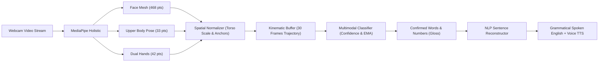

# SignNova - Multimodal Sign Language & Sentence Detector

> Real-time American Sign Language (ASL) detection recognizing **words and numbers** (excluding isolated alphabets) with **hand gestures, upper body posture, and facial expressions**, converted into fluent, grammatical English sentences via an **NLP sentence model**.

Inspired by the dark-theme glassmorphism UI of [SignSpeak](https://sign-speak-alpha.vercel.app/), **SignNova** advances sign recognition to complete multimodal communication.

---

## 🌟 Key Features

1. **Multimodal Holistic Tracking (543 Landmarks)**:
   - **Hands**: 21 landmarks per hand (42 total) tracking finger curl, pinches, thumb abduction, and two-hand coordination.
   - **Pose & Upper Body**: 33 landmarks tracking shoulder anchors, elbows, wrists, and chest posture.
   - **Face Mesh**: 468 landmarks capturing vital ASL non-manual grammar markers (eyebrow furrowing for WH-questions, eyebrow raising for yes/no, mouth shapes, and nods).

2. **Words and Numbers (No Alphabets)**:
   - Dedicated solely to high-frequency **words** (`Hello`, `Thank You`, `Please`, `Help`, `Yes`, `No`, `Water`, `Food/Eat`, `Want`, `Need`, `I Love You`, `What`, `Where`, `How`, etc.) and **numbers** (`0` to `10`, `20`, etc.).
   - Eliminates tedious single-letter fingerspelling in favor of natural conversational signing.

3. **High-Accuracy Kinematic Detection Engine**:
   - **Torso-relative Normalization**: Landmarks are scaled by shoulder distance, making detection invariant to distance from webcam.
   - **Facial & Body Anchoring**: Accurately recognizes spatial signs (e.g. `Eat` touching mouth, `Thank You` arcing from chin, `Hello` saluting from forehead, `Please` over sternum).
   - **Rolling 30-Frame Trajectory Buffer**: Captures velocity vectors, directional movement, and stroke dynamics.
   - **Resting Hand & Idle Suppression**: Prevents false triggers when hands are relaxed or resting below chest.

4. **NLP Sentence Reconstructor & Text-to-Speech**:
   - Converts raw ASL gloss streams (e.g. `[HELLO] [I] [WANT] [EAT] [2] [FOOD] [THANK YOU]`) into natural spoken English (`"Hello! I would like to have two meals, thank you."`).
   - Automatically handles **number quantification**, **copula verb insertion ("is/am/are")**, **articles**, and **question inversion**.
   - Built-in **Text-to-Speech (TTS)** voice readout with rate/pitch control.
   - Optional **Cloud Generative AI Reconstructor** (Google Gemini API support).

5. **Huge Dataset Architecture & Studio**:
   - Integrated with international sign benchmarks:
     - **WLASL**: 2,000 words, 21,083 video instances.
     - **MS-ASL**: 1,000 signs, 25,513 video samples.
   - **In-Browser Sample Collector**: Record 30-frame multimodal landmark sequences for any custom word or number.
   - **Export & Import**: Download your dataset in JSON format or import community datasets.
   - **Python Deep Learning Pipeline**: Ready-to-run PyTorch scripts in `scripts/` to train BiLSTM Attention models on the full WLASL dataset.

---

## 🚀 Getting Started

### 1. Start Development Server
```bash
npm run dev
```
Open [http://localhost:5173](http://localhost:5173) in your browser.

### 2. Build for Production
```bash
npm run build
npm run preview
```

---

## 📁 Project Architecture

```
SIGNOVA - 2/
├── index.html                           # MediaPipe Holistic & Google Fonts scripts
├── package.json                         # React 18, Vite 5, Tailwind CSS, Lucide icons
├── tailwind.config.js                   # Theme with glassmorphism & neon gradients
├── src/
│   ├── main.jsx                         # Application entry
│   ├── App.jsx                          # Main coordinator, navigation & layout
│   ├── index.css                        # Glass-card styles, glow effects & animations
│   ├── data/
│   │   └── vocabulary.js                # Dictionary of words & numbers (hand, body, face cues)
│   ├── services/
│   │   ├── holisticDetectionEngine.js   # 543-landmark kinematic classification engine
│   │   ├── nlpSentenceService.js        # ASL Gloss-to-English grammar engine & TTS
│   │   └── datasetManager.js            # Large-scale dataset collector & export/import
│   └── components/
│       ├── Navbar.jsx                   # Sticky glass navigation & status pills
│       ├── DetectionStudio.jsx          # Live video feed, canvas skeleton & recognition HUD
│       ├── SentenceBuilder.jsx          # Dual gloss-to-sentence converter with speech
│       ├── VocabularyGuide.jsx          # Encyclopedia of words/numbers with practice mode
│       ├── DatasetStudio.jsx            # WLASL benchmark studio & sample recorder
│       └── SettingsModal.jsx            # Sensitivity, voice, and AI API config
└── scripts/
    ├── download_wlasl.py                # WLASL 2,000-word dataset downloader
    └── train_holistic_model.py          # PyTorch BiLSTM Attention model trainer
```

---

## 🧠 How the Multimodal Engine Works



---

## 🛠️ Python Dataset Pipeline (Optional)

To download and train on the huge WLASL dataset:
```bash
pip install opencv-python mediapipe torch numpy
python3 scripts/download_wlasl.py
python3 scripts/train_holistic_model.py --classes 100 --epochs 30
```
